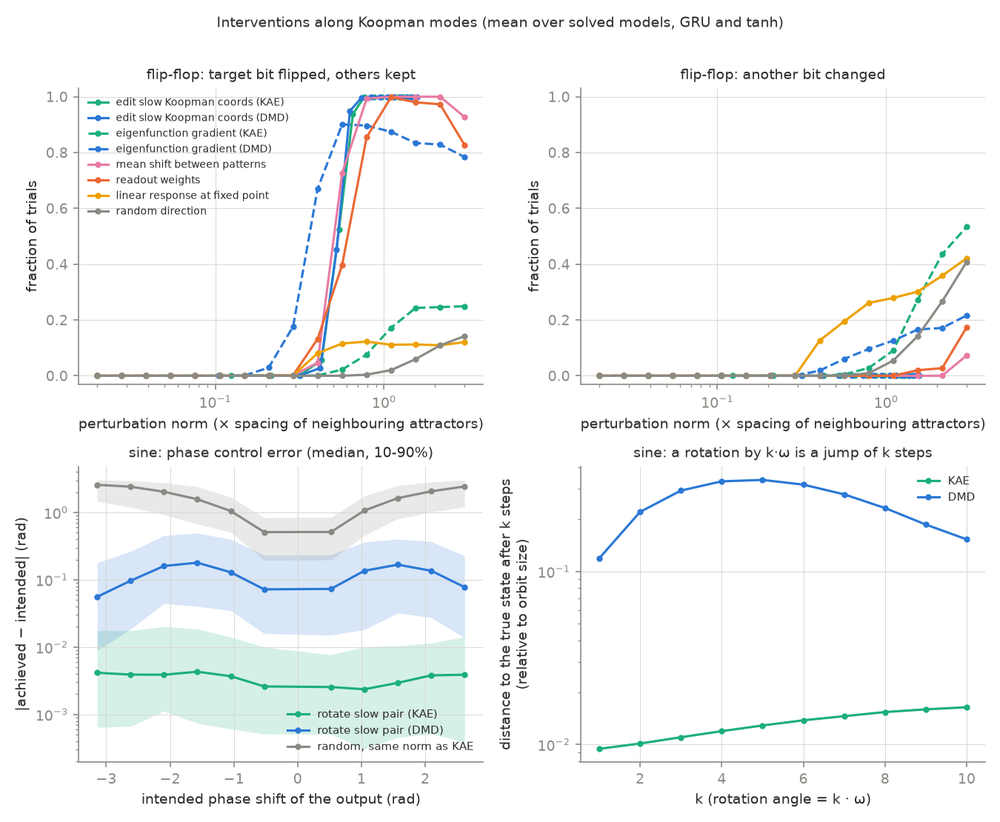

# Koopman spectra of trained RNNs

**Question.** Can a linear Koopman model of a trained nonlinear RNN show
what the network computes, and can it steer the network?

**Answer, on small networks: yes, for the slow dynamics.**

- **Memory.** A 3-bit flip-flop RNN has 8 stable fixed points. A Koopman
  autoencoder finds exactly 3 eigenvalues at 1.000, one per bit (12 of 12
  fits). The Jacobians at the fixed points do not show the memory
  (|λ| ≤ 0.89).
- **Oscillation.** A sine-generating RNN gives one eigenvalue pair at
  e^(±iω). Affine DMD on the raw states also needs the harmonics 2ω and 3ω.
- **Steering a bit.** An affine edit of the 3 slow Koopman coordinates
  flips the chosen bit in 100% of trials and never changes the other bits.
  It does not need less perturbation than a mean shift between memory
  patterns.
- **Steering the phase.** A rotation of the slow pair by α shifts the
  output phase by α, with a median error of 0.002–0.008 rad.



Short report, in bullet points: [`report/report.pdf`](report/report.pdf).
All numbers: [`report/tables.md`](report/tables.md), generated by
`scripts/07_report_tables.py`.

## Setup

- **Tasks:** 3-bit flip-flop, sine generation, delayed match-to-sample.
- **Models:** tanh RNN and GRU, 64 units, 3–5 seeds. 20 of 22 models solve
  their task.
- **Dynamics studied:** the autonomous map `F(h) = f(h, x*)` with a fixed
  input, sampled from perturbed relaxations.
- **Linear models of F:** Jacobians at fixed points, affine DMD, and a
  Koopman autoencoder (MLP encoder/decoder, one dense 16×16 operator).

## Reproduce

Laptop CPU, about one hour in total.

```bash
uv sync && uv run pytest -q
uv run python scripts/01_train.py
uv run python scripts/01_train.py --tasks dms --seeds 3 4
uv run python scripts/02_linear_analysis.py
uv run python scripts/03_koopman_ae.py
uv run python scripts/04_interventions.py
uv run python scripts/06_dms_memory.py
uv run python scripts/05_figures.py
uv run python scripts/07_report_tables.py
```

## Related work

- Sussillo & Barak (2013), fixed points of trained RNNs.
- Lusch, Kutz & Brunton (2018), Koopman autoencoders.
- Danieli et al. (2025), ParaRNN: Newton linearisation of nonlinear RNNs.
- Rodríguez et al. (2024, 2025), AcT and LinEAS: affine activation steering.

MIT license.
