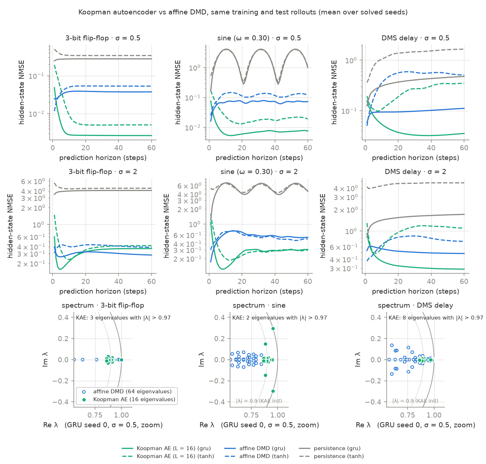
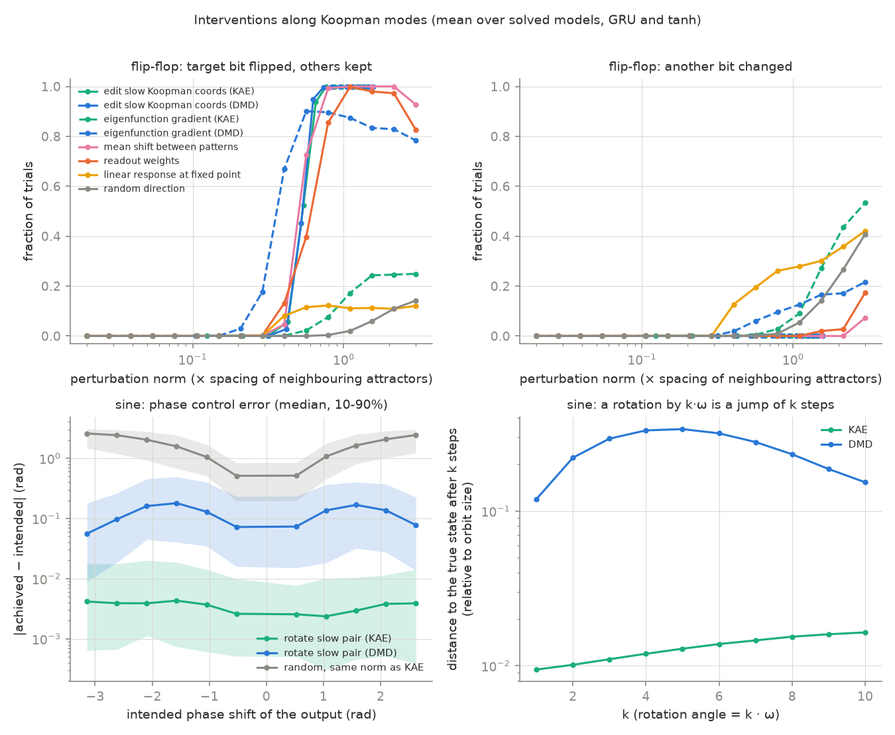

## Question

- Can a linear Koopman model of a trained nonlinear RNN show what the network
  computes?
- Can its eigenvalues and modes steer the network?

## Setup

- **Tasks:** 3-bit flip-flop (Sussillo & Barak, 2013), sine generation
  ($\omega \in [0.1, 0.6]$ rad/step), delayed match-to-sample (DMS).
- **Models:** tanh RNN and GRU, 64 units. 3 seeds per task, 5 for DMS.
  20 of 22 models solve their task. The analyses use only these.
- **Dynamics studied:** the autonomous map $F(h) = f(h, x^*)$, with the input
  held fixed. Data: visited states plus Gaussian noise of size $\sigma$,
  iterated under $F$.
- **Three linear models of $F$:**
    - Jacobians at the fixed points (local).
    - Affine DMD on the hidden states (global, observables $\{1, h\}$).
    - Koopman autoencoder, KAE (global, learned observables): MLP encoder and
      decoder, one dense $16 \times 16$ operator $K$. Loss: reconstruction,
      latent linearity over 30 steps, state prediction.

## Result 1: the global spectrum shows the computation

- **Flip-flop.** Each model has 8 stable fixed points. Their Jacobians are
  contracting ($|\lambda| \le 0.77$ GRU, $\le 0.89$ tanh): no local
  direction stores a bit.
- The KAE has **exactly 3 eigenvalues at 1.000** in 12 of 12 fits, one per
  bit. DMD has 3–6 eigenvalues above 0.97.
- **Reason.** Each basin of attraction is invariant, so its indicator is a
  Koopman eigenfunction with eigenvalue 1. Three such functions encode
  $2^3$ basins.
- **Sine.** The KAE has **one pair at $|\lambda| = 1.000$, phase $= \omega$**
  in 12 of 12 fits. DMD also needs the harmonics $2\omega$ and $3\omega$.
- **Prediction.** For $\sigma = 0.5$ the KAE predicts the hidden state 1.6–17
  times better than DMD at 10 steps, on all 20 models.

{width=72%}

## Result 2: the slow Koopman coordinates steer the network

- **Flip a bit without input.** Move the 3 slow Koopman coordinates a fraction
  $\lambda$ towards the target memory pattern, then decode. This is the affine
  transport of AcT (Rodríguez et al., 2024), applied in Koopman coordinates
  instead of neurons.
    - Success: **100%** on 6 of 6 models. Other bits changed: **never**.
    - Directions that fail: the gradient of the KAE's slow eigenfunction
      ($\le 39\%$, because a basin indicator is flat inside the basin), and
      the linear response at the nearest fixed point ($\le 27\%$).
- **Shift the phase.** Rotate the slow pair by $\alpha$, then decode.
    - Output phase error: median **0.002–0.008 rad**. Amplitude unchanged.
    - A rotation by $k\omega$ equals $k$ steps of the network (error 0.5–3%
      of the orbit size).
    - The same edit with DMD is 10 times less precise.

{width=72%}

## Limitations

- The bit edit **does not need less perturbation than a mean shift** between
  memory patterns. Both use the pattern means, that is, labels.
- The KAE learns only the slow spectrum. Its fast eigenvalues stay near
  their initialisation (0.9).
- For large perturbations ($\sigma = 2$) the KAE predicts worse than DMD at
  60 steps on 4 of 6 flip-flop models.
- Small networks, simple tasks, 3–5 seeds. Hyperparameters were chosen on one
  model that is also evaluated.

## Next steps

- Learn the steering map end to end in Koopman coordinates, with sparsity on
  the modes, as LinEAS (Rodríguez et al., 2025) does on neurons.
- Apply the analysis to diagonal recurrent cells (ParaGRU, Danieli et al.,
  2025), whose Jacobians are diagonal.
- Test larger recurrent models, where the answer is not known in advance.

## References

- Danieli, F. et al. (2025). ParaRNN: Unlocking parallel training of nonlinear RNNs for large language models. arXiv:2510.21450.
- Lusch, B., Kutz, J. N., Brunton, S. L. (2018). Deep learning for universal linear embeddings of nonlinear dynamics. *Nat. Commun.* 9, 4950.
- Mauroy, A., Mezić, I. (2016). Global stability analysis using the eigenfunctions of the Koopman operator. *IEEE TAC* 61(11), 3356–3369.
- Rodríguez, P. et al. (2024). Controlling language and diffusion models by transporting activations. arXiv:2410.23054.
- Rodríguez, P. et al. (2025). LinEAS: End-to-end learning of activation steering with a distributional loss. arXiv:2503.10679.
- Sussillo, D., Barak, O. (2013). Opening the black box. *Neural Comput.* 25(3), 626–649.
